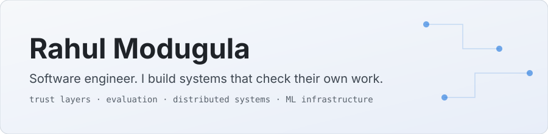
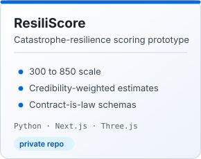
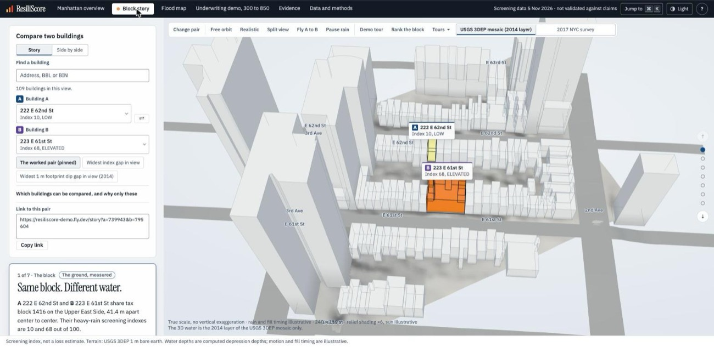
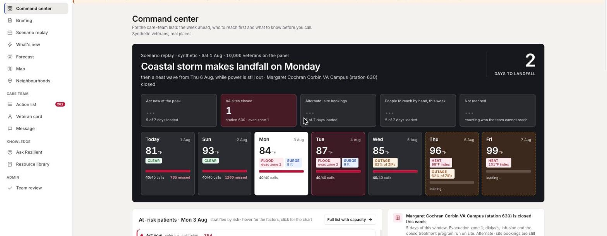
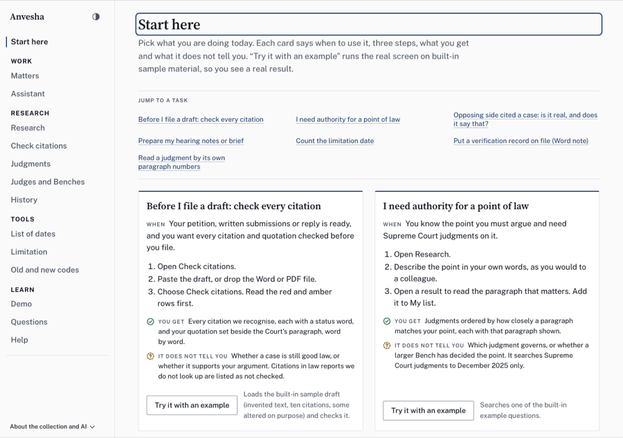
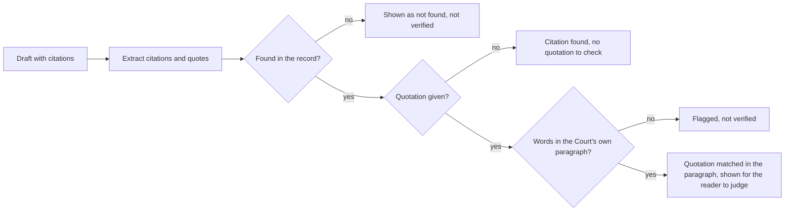

<picture>
  <source media="(prefers-color-scheme: dark)" srcset="assets/header-dark.svg">
  <source media="(prefers-color-scheme: light)" srcset="assets/header-light.svg">
  
</picture>

AI engineer in New York. I build LLM and retrieval systems, and the evaluation that keeps them honest. I like software where the hard part is being **right**, not just fast: verification that fails closed, evaluations decided before the results exist, and pipelines that can prove what they did. Virginia Tech CS, class of 2026. US work authorized (F-1 OPT).

**Reach me:** [LinkedIn](https://www.linkedin.com/in/rahulmodugula3/) · [Email](mailto:rahulmodugula3@gmail.com)

## Featured

<table>
  <tr>
    <td align="center" valign="top">
      <a href="#resiliscore-private-repo">
        <picture>
          <source media="(prefers-color-scheme: dark)" srcset="assets/card-rs-dark.svg">
          
        </picture>
      </a>
    </td>
    <td align="center" valign="top">
      <a href="#rezilient-hackathon-team-project">
        <picture>
          <source media="(prefers-color-scheme: dark)" srcset="assets/card-rz-dark.svg">
          
        </picture>
      </a>
    </td>
    <td align="center" valign="top">
      <a href="#sovereign-legal-ai-private-repo">
        <picture>
          <source media="(prefers-color-scheme: dark)" srcset="assets/card-sla-dark.svg">
          
        </picture>
      </a>
    </td>
  </tr>
</table>

These three live in private repositories, so each card links to its write-up below. The public projects are further down.

## See it in action

**ResiliScore: same block, different water.** A true-scale 3D model of one Manhattan block, built with Three.js on public elevation data, shows why two neighbours can screen differently for heavy-rain flooding: orbit it, fly from one building to the other, and watch the water pool. The page states what it is not: a screening index, not a rating, not a loss estimate, and not validated against claims. [Open the live demo](https://resiliscore-demo.fly.dev/story?a=739943&b=795604).

<table>
  <tr>
    <td width="50%" valign="top">
      
       <b>Rezilient: the week ahead for a care team.</b> A replay of a synthetic storm-then-heat-wave week over synthetic veterans in real places, with the day-by-day hazards and who to reach first. A banner says the model is priors only and not fitted, and a person sends every message. <a href="https://rezilient-va.fly.dev/">Open the live demo</a>.
    </td>
    <td width="50%" valign="top">
      
       <b>Sovereign Legal AI: check a draft before filing.</b> Paste it or drop the file, and every citation gets a status word with the quotation set beside the Court's paragraph. Each card also says what it does not tell you, such as whether a case is still good law. <a href="https://slai-staging.fly.dev/">Try the live demo</a>: a staging preview over public judgments, so do not enter real client material.
    </td>
  </tr>
</table>

All screens use synthetic or built-in sample data. These are prototypes, not validated products.

## Experience

**AI Engineer, Forte Construction Corp** (NYC public-works general contractor) · Aug 2026 to present
- Architected and own a production **LLM agentic RAG platform on AWS Bedrock** over multi-terabyte project specs, RFIs, submittals, drawings and email, with cited answers, explicit refusals and per-job access control on every read.
- Added **Primavera P6 schedule analysis** (.xer/.xml): picks the correct schedule update and returns critical path, drivers, look-aheads, baseline variance and DCMA-14-style health checks.
- Raised **document hit rate from 0.28 to 0.91** (n=750, offline) through pre-registered paired tests of retrieval changes, including hybrid BM25 plus dense retrieval with reranking; a finished-answer check cut judged-wrong answers from 7 to 0.
- Shipped **150+ release candidates** through fail-closed, post-deploy-verified CI/CD (27,000+ automated tests, 98% green CI) with PII gating and refusal probes on each release; made about 6,000 scanned PDFs searchable for under $100.
- Directed a parallel **AI-assisted engineering workflow** (builder agents, independent verifier, human approval) that merged about 900 PRs in ten weeks, now in active beta; cut complexity with golden and mutation tests.

**AI Software Engineer, ncoder.ai** (AI startup, remote) · May to Aug 2025
- Architected a **multi-agent LangGraph framework** with Graph RAG over Neo4j and pgvector for Salesforce code modernization.
- Took a client product from **concept to production in 48 hours**; demoed to 2 S&P 500 clients, winning signed pilots.
- Engineered GCP microservices (FastAPI, PostgreSQL, Kubernetes): **throughput 3x, deploy time down 75%**.
- Built AI code analysis over **10M+ lines of code per day**, mapping tech debt and dependencies; cut audit effort 50%.

**AI Software Engineering Intern, Darsa AI** (computer vision startup, Hyderabad) · May to Aug 2024
- Trained real-time **PyTorch object detection** models: 35% higher accuracy and 45% lower latency via pruning and quantization.
- Designed fault-tolerant REST APIs sustaining **99.95% uptime at 100,000+ daily requests**.

**Undergraduate researcher, Hume Center, Virginia Tech** · 2.5 years: 2 peer-reviewed publications in AI/ML and HCI.

## Education

**Virginia Tech**, B.S. Computer Science, GPA 3.65/4.0 · Aug 2023 to May 2026 · 5x Dean's List.

## Selected work

### ResiliScore (private repo)

A parcel-level pluvial flood screening index for NYC, with a 3D Manhattan explorer and a block-by-block flood story. Solo-built and publicly auditable by design. It is a screening index, not a rating, and its coefficients are unvalidated; the code labels them that way.

- **Pre-registered back-test.** A citywide Hurricane Ida back-test (5,927 block groups, 29,601 FEMA aid registrations; the outcome is aid registrations, not losses): rate ratio 1.41 per SD (95% CI 1.30 to 1.52), held out under spatial leave-block-out. Sized in advance (smallest detectable rate ratio 1.15 at 80% power).
- **Terrain factors.** Confirmed 2 of 5 candidate terrain factors on 49,239 lots in 4 unseen basins; leave-one-basin-out AUC 0.69 to 0.74.
- **Audit trail.** One-shot signed pre-registrations, guarded bootstrap intervals, SHA-256 provenance, a public evidence pack, a failures log, and a mutation-tested core (919 mutants, 99.2% killed). 48 design decisions are written down, and the repo says plainly which model constants have no outcome test yet.
- **Performance.** A 3D layer toggle across 44,935 buildings went from 4,889 ms to 28 ms; the scoring API p95 is 8 to 13 ms in process.
- **Shipped end to end in 27 days:** 569 commits, 305 PRs, about 65k lines of Python and TypeScript, 3,000+ tests.
- **Stack.** Python, FastAPI, Next.js, React, TypeScript, Three.js, negative-binomial regression, Playwright, Fly.io.

### Rezilient (hackathon team project)

Decision support that turns a climate forecast into a ranked outreach list for care teams. **Second place of 60 teams** at the Health in Climate AI Hackathon with the UN Climate Change Global Innovation Hub, 2026, selected for Groundwork. I led engineering for a five-person team.

- **Hierarchical Bayesian model** in NumPyro and JAX (NUTS, 935 parameters, max R-hat 1.0063) over 22 public datasets.
- **Simulation result, not a field result.** In a 10,000-veteran synthetic simulation, the plan averted 23.7 units of harm per day at 40 calls versus 4.9 for the best baseline. All people are synthetic and places are real.
- **Safety enforced in tests.** A pharmacist approves every medication change, a person sends every message, and sensitive-record redaction (38 USC 7332) is tested. No real patient data is used; PHI ingestion is prohibited by repository rule.
- **Stack.** Python, NumPyro, JAX, polars, FastAPI, React, deck.gl.

### Sovereign Legal AI (private repo)

A research and citation-checking tool built for Indian advocates over public judgments: more than 38k Supreme Court judgments and millions of High Court records. It is built to fail closed on a citation it cannot find. It is a preview built on public material, and its known gaps are tracked openly.

- **My role.** Owner and solo engineer.
- **ML angle.** Retrieval and ranking (full-text search plus dense retrieval and a reranker), with evaluation gates pre-registered before runs, held-out splits, fixed seeds and confidence intervals.
- **Fail-closed by design.** Name and year matching alone is not enough to verify a citation, and a quotation is meant to count only when its words are found in the Court's own paragraph. It checks a draft with no model call.
- **Tests that must fail.** Any change that could turn a failure into "verified" must ship with a fabricated-citation test that proves it still fails.
- **Stack.** Python, FastAPI, Pydantic, SQLite FTS5, numpy, local OCR (including Telugu and Hindi), Fly.io.

The diagram is the design intent, a check and not a guarantee. It checks that a citation and quotation exist in the judgment text; it does not say whether the authority is still good law.

## More public projects

| Project | What it is |
| --- | --- |
| [athena](https://github.com/RahulModugula/athena) | RAG-powered research assistant with hybrid search (pgvector + BM25), cross-encoder reranking and RAGAS evaluation. |
| [odin](https://github.com/RahulModugula/odin) | AI-powered multi-agent code review combining Tree-sitter AST analysis with LLM agents. |
| [witness](https://github.com/RahulModugula/witness) | A service that watches a procedure video and proves what happened, when, and by whom. Open-vocab object detection + tracking + hand-pose interaction logic. |
| [quantai-dashboard](https://github.com/RahulModugula/quantai-dashboard) | Real-time quantitative finance dashboard: options pricing (Black-Scholes), portfolio optimization (Markowitz) and risk analytics with Streamlit. |
| [streamline](https://github.com/RahulModugula/streamline) | Real-time event pipeline: GitHub Archive to Kafka to Spark Structured Streaming to Delta Lake, with exactly-once semantics and schema evolution. |
| [kronos](https://github.com/RahulModugula/kronos) | Distributed job scheduler in Go: gRPC, PostgreSQL, worker pool, retries. |

## How I work

Tests first. Pre-registered evaluations. Fail-closed defaults. No secrets and no client data in repos.

**AI/ML:** LLMs · retrieval-augmented generation (RAG) · AI agents (LangGraph, LangChain) · LLM evaluation · hybrid search and reranking · Bayesian modelling (NumPyro, JAX) · PyTorch · OpenCV · YOLO

**Backend and data:** Python · TypeScript · Go · SQL · FastAPI · Node.js · PostgreSQL · pgvector · Neo4j · Redis · Spark · Kafka

**Cloud and DevOps:** AWS (Bedrock) · GCP · Docker · Kubernetes · CI/CD · GitHub Actions · Fly.io

**Frontend:** React · Next.js · three.js · deck.gl

**Domains:** construction documents, Primavera P6 scheduling, healthcare data (OMOP, Synthea), geospatial (PLUTO, FEMA)

## Get in touch

I am happy to talk about AI engineering, evaluation design, or any of the work above. [LinkedIn](https://www.linkedin.com/in/rahulmodugula3/) or [email](mailto:rahulmodugula3@gmail.com).
