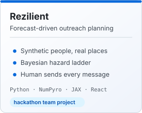
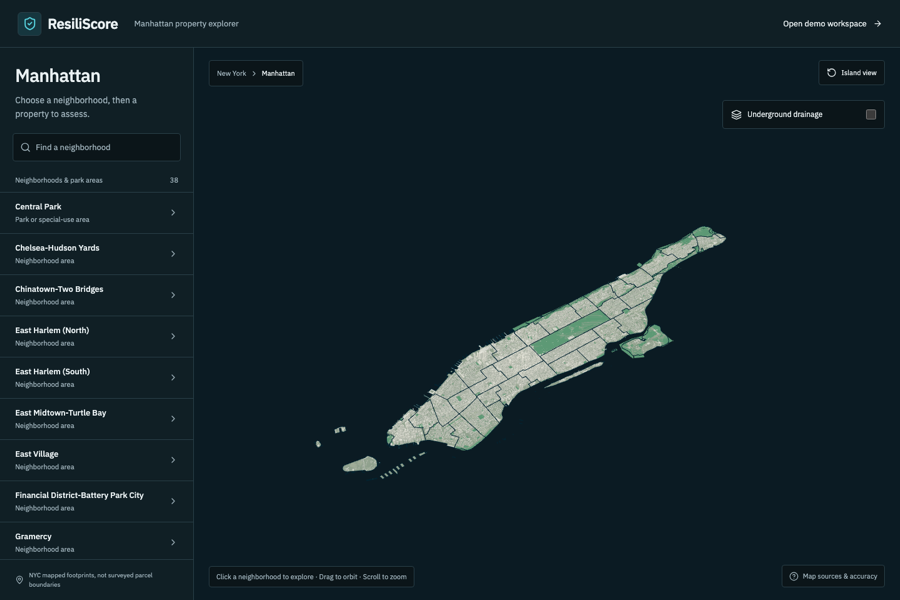
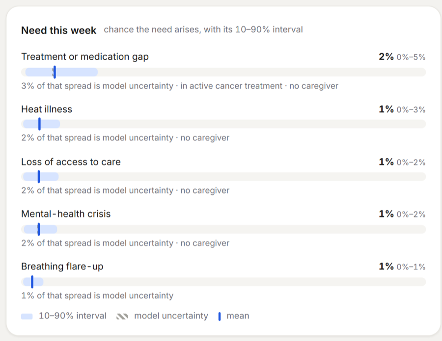
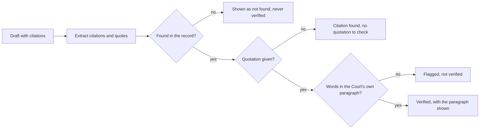

<picture>
  <source media="(prefers-color-scheme: dark)" srcset="assets/header-dark.svg">
  <source media="(prefers-color-scheme: light)" srcset="assets/header-light.svg">
  
</picture>

I build models, retrieval systems and the evaluation that keeps them honest. I like software where the hard part is being **right**, not just fast: verification that fails closed, evaluations decided before the results exist, and pipelines that can prove what they did. Looking for new grad / early-career roles (F-1 OPT eligible).

**Reach me:** [LinkedIn](https://www.linkedin.com/in/rahulmodugula3/) · [Email](mailto:rahulmodugula3@gmail.com)

## Featured

<table>
  <tr>
    <td align="center" valign="top">
      <a href="#resiliscore-private-repo">
        <picture>
          <source media="(prefers-color-scheme: dark)" srcset="assets/card-rs-dark.svg">
          
        </picture>
      </a>
    </td>
    <td align="center" valign="top">
      <a href="#rezilient-hackathon-team-project">
        <picture>
          <source media="(prefers-color-scheme: dark)" srcset="assets/card-rz-dark.svg">
          
        </picture>
      </a>
    </td>
    <td align="center" valign="top">
      <a href="#sovereign-legal-ai-private-repo">
        <picture>
          <source media="(prefers-color-scheme: dark)" srcset="assets/card-sla-dark.svg">
          
        </picture>
      </a>
    </td>
  </tr>
</table>

These three live in private repositories, so each card links to its write-up below. The public projects are further down.

## See it in action

<table>
  <tr>
    <td width="33%" valign="top">
      
       <b>ResiliScore.</b> Pick a neighborhood on the 3D Manhattan map, then a property, and get a screening where the evidence status is shown explicitly. The footer says what the map is not: mapped footprints, not surveyed parcel boundaries.
    </td>
    <td width="33%" valign="top">
      
       <b>Rezilient.</b> For a synthetic person, the chance each need arises this week, with a 10 to 90% interval and how much of the spread is model uncertainty. The care team's daily capacity then decides who is contacted, and a person sends every message.
    </td>
    <td width="33%" valign="top">
      
       <b>Sovereign Legal AI.</b> Check a draft before filing: paste it or drop the file, and every citation gets a status word with the quotation set beside the Court's paragraph. Each card also says what it does not tell you, such as whether a case is still good law.
    </td>
  </tr>
</table>

All screens use synthetic or built-in sample data. These are prototypes, not validated products.

## Selected work

### ResiliScore (private repo)

A prototype exploring catastrophe-resilience scoring for properties on a 300 to 850 scale, with a 3D Manhattan explorer. Its coefficients are unvalidated, and the code labels them that way.

- **My role.** Owner and engineer.
- **ML angle.** Credibility weighting: census-tract losses are blended with parcel-level evidence (Bühlmann-Straub).
- **Contract is law.** Shared JSON schemas and pinned golden numbers change together, enforced by a sync test.
- **Honest limits.** Most model constants have no outcome test yet, and the repo says so. 48 numbered design decisions are written down.
- **Stack.** Python, FastAPI, Next.js, React, TypeScript, Three.js, Playwright, Fly.io.

### Rezilient (hackathon team project)

A prototype that turns a climate forecast into a ranked outreach list for care teams. Second place at the Health in Climate AI Hackathon NYC 2026, built with a team.

- **My role.** I own the repo and work on the code with a teammate; the hackathon build was a team effort.
- **ML angle.** A Bayesian model in NumPyro and JAX, built as a ladder of increasingly fitted models.
- **Synthetic people, real places.** All people are synthetic, places are real, and every real number is cited. No PHI in the repo.
- **Human in the loop.** The model ranks actions within capacity. A person sends every message, and medication questions are flagged to a pharmacist.
- **Stack.** Python, NumPyro, JAX, polars, FastAPI, React, deck.gl.

### Sovereign Legal AI (private repo)

A research and citation-checking tool built for Indian advocates. It is designed so that a citation it cannot find is never shown as verified. It is a preview built on public material, and its known gaps are tracked openly.

- **My role.** Owner and solo engineer.
- **ML angle.** Retrieval and ranking over public Supreme Court judgments and High Court records (full-text search plus dense retrieval and a reranker), with evaluation gates pre-registered before runs, held-out splits, fixed seeds and confidence intervals.
- **Fail-closed by design.** Name and year matching alone is not enough to verify a citation, and a quotation is meant to count only when its words are found in the Court's own paragraph.
- **Tests that must fail.** Any change that could turn a failure into "verified" must ship with a fabricated-citation test that proves it still fails.
- **Stack.** Python, FastAPI, Pydantic, SQLite FTS5, numpy, local OCR (including Telugu and Hindi), Fly.io.

The diagram is the design intent. It checks that a citation and quotation exist in the judgment text; it does not say whether the authority is still good law.

## More public projects

| Project | What it is |
| --- | --- |
| [athena](https://github.com/RahulModugula/athena) | RAG-powered research assistant with hybrid search (pgvector + BM25), cross-encoder reranking and RAGAS evaluation. |
| [odin](https://github.com/RahulModugula/odin) | AI-powered multi-agent code review combining Tree-sitter AST analysis with LLM agents. |
| [witness](https://github.com/RahulModugula/witness) | A service that watches a procedure video and proves what happened, when, and by whom. Open-vocab object detection + tracking + hand-pose interaction logic. |
| [quantai-dashboard](https://github.com/RahulModugula/quantai-dashboard) | Real-time quantitative finance dashboard: options pricing (Black-Scholes), portfolio optimization (Markowitz) and risk analytics with Streamlit. |
| [streamline](https://github.com/RahulModugula/streamline) | Real-time event pipeline: GitHub Archive to Kafka to Spark Structured Streaming to Delta Lake, with exactly-once semantics and schema evolution. |
| [kronos](https://github.com/RahulModugula/kronos) | Distributed job scheduler in Go: gRPC, PostgreSQL, worker pool, retries. |

## How I work

Tests first. Pre-registered evaluations. Fail-closed defaults. No secrets and no client data in repos.

**ML and data:** Bayesian modelling (NumPyro, JAX) · retrieval and reranking · RAG and evaluation design · PyTorch · scikit-learn · OpenCV · Spark and Kafka pipelines

**Systems:** Python · Go · TypeScript · FastAPI · PostgreSQL · SQLite · Docker · Fly.io · GitHub Actions

## Get in touch

I am happy to talk about AI/ML engineering roles, evaluation design, or any of the work above. [LinkedIn](https://www.linkedin.com/in/rahulmodugula3/) or [email](mailto:rahulmodugula3@gmail.com).
